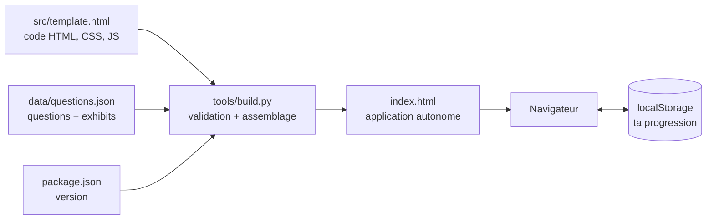
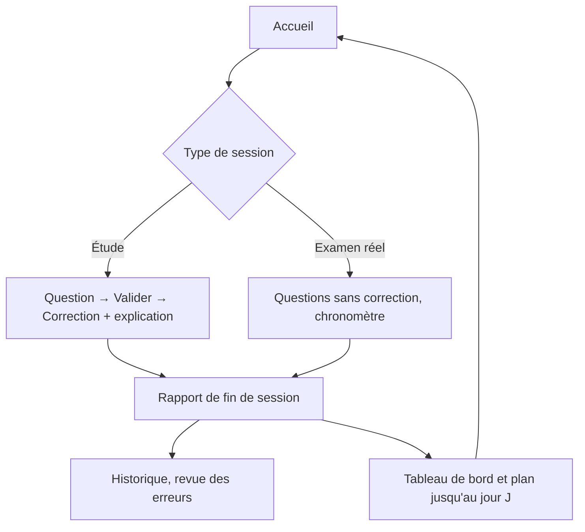

# NSE4-FGT Trainer

**Simulateur d'examen et coach de révision pour la certification Fortinet NSE 4 — FortiOS 7.6 Administrator (FCP).**


> Une seule page web. Pas de serveur, pas de compte, pas d'installation : tout tourne dans le navigateur et ta progression reste sur ta machine.

---

## Pourquoi ce projet

Pour réussir le CCNA 200-301, j'avais préparé l'examen avec Boson ExSim : des examens blancs dans les conditions réelles (chronomètre, aucune correction pendant l'épreuve, rapport détaillé à la fin). Cette façon de s'entraîner fait toute la différence entre *connaître* un cours et *réussir* un examen.

Pour le NSE 4 FortiGate Administrator, je n'ai trouvé aucun équivalent : pas de plateforme d'entraînement permettant de se placer dans les conditions réelles de l'épreuve. Après un premier essai manqué le 25 août 2026, malgré cinq mois de formation, j'ai décidé de construire moi-même l'outil qui me manquait.

Ce dépôt est le résultat : une plateforme pour **s'entraîner comme le jour J**, mesurer sa progression honnêtement et savoir précisément quoi retravailler. Elle s'est ajoutée à mon travail avec les cours officiels de Fortinet et des cours assistés par IA. Prochaine tentative : le 8 décembre 2026.

### Ce que ce projet est, et n'est pas

**Ce n'est pas un « dump »** à mémoriser. C'est un **moteur de simulation et de coaching** : il reproduit les conditions de l'épreuve, entraîne à lire les exhibits FortiGate, mesure le rythme et la maîtrise par domaine officiel, et construit un plan jusqu'au jour J. Le moteur (code) et la banque de questions (données) sont deux choses séparées : voir [Contenu pédagogique](#contenu-pédagogique-et-avertissement).

---

## Fonctionnalités

**S'entraîner**
- **Mode Étude** : correction et explication détaillée après chaque réponse.
- **Mode Examen réel** : aucune correction avant la fin, chronomètre (1 minute par question), navigation libre, questions à marquer et à repasser, fin automatique à zéro. C'est le fonctionnement d'une session Pearson VUE.
- **Règle des réponses multiples** comme à l'examen : impossible de cocher plus de réponses qu'attendu, message d'erreur en cas de sélection incomplète.
- **Exhibits réels** (captures de GUI FortiGate, sorties CLI, topologies) intégrés aux questions, agrandissables.
- **Pool aléatoire intelligent** : les questions jamais vues ou récemment ratées reviennent plus souvent que celles déjà maîtrisées.
- **Examens blancs** prédéfinis, **filtre par thème**, révision des erreurs, questions marquées.

**Comprendre**
- **Coach FCP FortiGate** : pour chacun des 5 domaines officiels, concepts à connaître, pièges d'examen, éléments à repérer dans les exhibits, commandes CLI, questions associées et maîtrise personnelle.
- **Fiche méthode** de lecture d'un exhibit et de ses pièges classiques.

**Mesurer**
- **Rapport de fin de session** : score, temps total et moyen, maîtrise par domaine (pondérée selon le blueprint), forces, faiblesses, recommandations.
- **Tableau de bord** : indice de préparation sur 100, radar des 5 domaines, courbe de progression, rythme de réflexion par question et par domaine, questions « têtues ».
- **Historique des examens** avec **revue** : rouvrir une session passée avec ses réponses et la correction.

**Planifier**
- **Plan jusqu'au jour J** : compte à rebours, trois phases (couvrir, consolider, simuler), objectif quotidien calculé, nombre de simulations recommandées, série de jours consécutifs et calendrier d'activité.

**Personnaliser et sauvegarder**
- **Deux thèmes** (clair, sombre) et six couleurs d'accent.
- **Export / import** de toute la progression en un fichier JSON.

<!--
## Captures d'écran
Ajoute tes captures dans docs/screenshots/ puis supprime les marques de commentaire de cette section.

| Accueil (thème clair) | Mode Examen réel | Tableau de bord |
|---|---|---|
|  |  |  |
-->

---

## Démarrage rapide

1. Télécharge ou clone le dépôt.
2. Ouvre **`index.html`** dans un navigateur récent (Chrome, Edge, Firefox).

C'est tout. Aucun serveur, aucune installation, aucune connexion requise.

> **Bon à savoir** : la progression est stockée dans le `localStorage` du navigateur. Ouvre toujours l'application depuis le même navigateur, et pense à **exporter ta progression** (icône disquette) de temps en temps : vider le cache l'efface.

La seule requête externe est le chargement des polices Google Fonts, purement esthétique : sans connexion, l'application s'affiche avec les polices du système.

---

## Comment ça marche

L'application est un **fichier HTML autonome** : le code, la banque de questions et les images y sont embarqués. Le dépôt sépare ces éléments et les assemble à la demande.



Un parcours type :



Le détail complet (formules de l'indice de préparation, du tirage pondéré, du plan, format des données stockées) est dans **[docs/FONCTIONNEMENT.md](docs/FONCTIONNEMENT.md)**.

---

## Structure du dépôt

```
nse4-trainer/
├── index.html                  Application autonome (généré, à committer)
├── src/
│   └── template.html           Code de l'application (HTML, CSS, JavaScript)
├── data/
│   └── questions.json          Banque de questions (texte + exhibits en base64)
├── tools/
│   └── build.py                Validation de la banque + assemblage de index.html
├── tests/                      Tests automatiques (jsdom), horloge figée
├── docs/
│   ├── FONCTIONNEMENT.md       Fonctionnement détaillé et formules
│   └── AJOUTER-DES-QUESTIONS.md  Guide pour enrichir la banque
├── .github/workflows/tests.yml Intégration continue (build à jour + tests)
├── CHANGELOG.md
├── LICENSE
└── package.json
```

---

## Développement

Prérequis : **Python 3** (assemblage) et **Node.js 20+** (tests).

```bash
npm install          # installe jsdom pour les tests
python tools/build.py          # reconstruit index.html (valide la banque au passage)
python tools/build.py --check  # vérifie que index.html est à jour
npm test             # lance les 136 vérifications
```

Règle d'or : **on modifie `src/template.html` et `data/questions.json`, jamais `index.html` directement**. Après toute modification, reconstruire puis committer `index.html` avec le reste. La CI refuse un `index.html` périmé.

Les tests chargent l'application dans jsdom avec une **horloge figée** (31 octobre 2026) : ils ne dépendent pas de la date du jour, y compris après le jour de l'examen. Ils couvrent les modes de session, le calcul de l'indice et du plan, l'historique et la revue, la sauvegarde, les thèmes et la validation d'un fichier importé piégé. Ils ne remplacent pas un test visuel sur un vrai écran.

Pour ajouter des questions : **[docs/AJOUTER-DES-QUESTIONS.md](docs/AJOUTER-DES-QUESTIONS.md)**.

---

## Contenu pédagogique et avertissement

- Les **82 questions** fournies dans `data/` proviennent de documents d'étude tiers que j'ai importés pour ma préparation personnelle. Je les ai corrigées, classées par thème et par domaine officiel, et complétées d'explications en français quand elles manquaient.
- Ce contenu **n'est pas couvert par la licence MIT** et ne m'appartient pas. **Ce dépôt est privé pour cette raison** ; il ne doit pas être rendu public avec `data/`. Pour partager le moteur seul, publier une copie sans `data/` et fournir ses propres questions suffit : la procédure est décrite dans [docs/AJOUTER-DES-QUESTIONS.md](docs/AJOUTER-DES-QUESTIONS.md).
- Les scores, l'indice de préparation et les recommandations sont des **indicateurs d'entraînement**, pas une prédiction de réussite : Fortinet ne publie pas son seuil.
- Projet **indépendant, non affilié à Fortinet ni à Pearson VUE**. Fortinet, FortiGate, FortiOS et NSE sont des marques de Fortinet, Inc.

---

## Auteurs

- **Blanchard** ([@Blanchard-Jr](https://github.com/Blanchard-Jr)) : idée, cahier des charges, direction du projet, choix pédagogiques, contenus de révision, tests en conditions réelles et validation de chaque version.
- **Claude** (IA d'[Anthropic](https://www.anthropic.com)) : développement logiciel, conception de l'interface, tests automatiques et documentation, en dialogue constant avec Blanchard.

Ce projet a été construit à deux, itération après itération, à partir d'un besoin réel.

## Licence

Le **code** est publié sous licence [MIT](LICENSE). Les banques de questions en sont exclues (voir ci-dessus).
